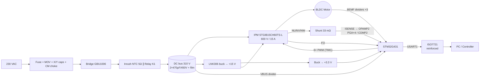

# ۱ — طراحی سخت‌افزار برد درایور BLDC (310 V DC)

## ۱.۱ مشخصات هدف

| پارامتر | مقدار |
|---|---|
| ورودی | 230 VAC ±15 %، 50/60 Hz، تک‌فاز ← باس DC حدود 310 V (276…373 V) |
| توان نامی خروجی محور | 750 W (پیوسته، با هیت‌سینک ≤ 2 K/W) |
| جریان فاز | 3.6 A rms نامی، حد نرم‌افزاری 6 A، حد سیکل‌به‌سیکل 10 A، قطع سخت‌افزاری IPM حدود 15 A |
| روش کنترل | Six-step (trapezoidal)، **Sensorless BEMF**، مد H_PWM-L_ON با یکسوسازی سنکرون |
| فرکانس PWM | 16 kHz (مناسب IGBT؛ تلفات سوئیچینگ ~3.6 W) |
| میکروکنترلر | STM32G431CBT6 (Cortex-M4F، 170 MHz، OPAMP/COMP/DAC داخلی) |
| حفاظت‌ها | OC سخت‌افزاری (IPM CIN)، cycle-by-cycle (COMP2)، OC نرم‌افزاری، OV/UV باس، OT هیت‌سینک، Stall، شکست استارت، Watchdog |
| رابط کاربر | UART ایزوله (ISO7721)، دکمه START/STOP، پتانسیومتر سرعت، دو LED |

## ۱.۲ بلوک دیاگرام



## ۱.۳ دلایل انتخاب‌های کلیدی

**IPM به جای MOSFET + گیت‌درایور گسسته.** در 310 V، حلقه‌های کموتاسیون، dv/dt حدود 5–10 V/ns و فاصله‌های
عایقی مهم‌ترین منبع خرابی‌اند. IPM کلاس 600 V/15 A (STGIB15CH60TS-L یا IKCM15L60GD یا FNB41560) این موارد را
یکجا دارد: سه نیم‌پل IGBT با دیود هرزگرد، درایور HVIC، دیود بوت‌استرپ، UVLO، اینترلاک (جلوگیری از shoot-through
حتی در صورت باگ فریمور)، مقایسه‌گر قطع جریان (CIN) و خروجی Fault. IGBT در 16 kHz و جریان چند آمپری بهینه‌تر از
MOSFET سیلیکونی 600 V است.

**Six-step sensorless.** برای فن، پمپ و کمپرسور (بار با گشتاور متناسب با سرعت) ساده‌ترین و مقاوم‌ترین روش است:
بدون سنسور هال (سیم‌کشی کمتر، مناسب موتورهای داخل محفظه/روغن)، با محاسبات سبک. محدودیت ذاتی: زیر ~10 %
سرعت نامی BEMF قابل‌اتکا نیست و استارت زیر بار سنگین/اینرسی خیلی بالا نیاز به تنظیم دارد (بخش ۲ و نتایج شبیه‌سازی).

**STM32G431.** تایمر پیشرفته TIM1 با preload کموتاسیون (COM event)، ورودی Break، OCREF_CLR از مقایسه‌گر
داخلی، دو ADC سریع با تریگر تزریقی از تایمر، OPAMP با PGA داخلی و DAC داخلی ⇒ هیچ آپ‌امپ یا مقایسه‌گر خارجی
لازم نیست.

## ۱.۴ ورودی AC، EMI و باس DC

| بخش | انتخاب | محاسبه/دلیل |
|---|---|---|
| فیوز | 10 A T | جریان ورودی بدترین حالت (195 VAC، PF≈0.6 بدون PFC) ≈ 7.5 A rms |
| MOV | S14K275 | سرج خط؛ بعد از فیوز |
| فیلتر EMI | X2 0.47 µF ×2، چوک CM 2×6.8 mH، Y2 2.2 nF به PE | فیلتر یک‌مرحله‌ای پایه؛ برای انطباق EN 55014 باید در آزمایشگاه EMC تست شود |
| پل | GBU1006 روی هیت‌سینک | تلفات ≈ 5 W |
| جریان هجومی | NTC 5 Ω + رله بای‌پس | قله ≈ 75 A در 264 VAC (IFSM پل = 220 A)؛ انرژی خازن ≈ 66 J ⇒ NTC باید برای این خازن رتبه داشته باشد |
| خازن باس | 2×470 µF/450 V | ریپل 100 Hz ≈ 28 V p-p در توان نامی؛ **جریان ریپل هر خازن ≈ 3.5 A** ⇒ خازن snap-in 105 °C با ریپل ≥ 3.6 A یا 3×330 µF |
| خازن فیلم | 1 µF/630 V + 100 nF/630 V چسبیده به IPM | مسیر جریان فرکانس‌بالا؛ حلقه P–N–شنت باید کوچک‌ترین حلقه برد باشد |

> ⚠️ **PFC:** با 750 W و ورودی خازنی، استاندارد هارمونیک IEC 61000-3-2 (کلاس A) احتمالاً پاس نمی‌شود. برای
> محصول تجاری یک PFC فعال (بوست CCM/CrCM، مثلاً با L4984D یا UCC28180) یا حداقل چوک PFC پسیو لازم است.
> این نسخه برد برای نمونه‌سازی و آزمایشگاه است.

## ۱.۵ طبقه قدرت (IPM) و تلفات

اعداد از `hardware/calc/bldc_calc.py` (پارامترهای [DS] را با دیتاشیت پارت نهایی جایگزین کنید):

| کمیت | مقدار |
|---|---|
| دیوتی در سرعت نامی (3000 rpm، Ke=0.573 V·s/rad) | ≈ 0.59 (در شبیه‌سازی با بار فن ≈ 0.75) |
| جریان فاز (تخت) / rms | 4.4 A / 3.6 A |
| تلفات هدایتی IPM | ≈ 9.3 W |
| تلفات سوئیچینگ + بازیابی | ≈ 3.6 W |
| تلفات پل | ≈ 5.0 W |
| Rth(s-a) لازم برای Tj = 125 °C در Ta = 50 °C | ≤ 3.2 K/W ⇒ **انتخاب ≤ 2.0 K/W** برای حاشیه قفل‌شدن روتور |

**بوت‌استرپ:** در H_PWM-L_ON سوئیچ بالای فاز PWM‌شونده در هر سیکل در بازه OFF شارژ می‌شود. با
`DUTY_MAX = 0.96` پنجره شارژ 2.5 µs است؛ با مقاومت مسیر 50 Ω افت تعادلی ≈ 1.4 V و Vbs ≈ 12.9 V
(بالای UVLO). خازن 4.7 µF X7R (≥ 1.4 µF لازم). قبل از هر استارت، فریمور 10 ms همه low-side ها را روشن می‌کند
(`PRECHARGE`). اگر IPM دیگری با مقاومت دیود داخلی بزرگ‌تر انتخاب شد، `DUTY_MAX` را کم کنید یا دیود فوق سریع
خارجی + 10 Ω بگذارید.

**پلاریته ورودی‌ها:** در برخی IPMها LIN فعال-پایین است. فریمور با `IPM_HIN_ACTIVE_LOW` / `IPM_LIN_ACTIVE_LOW`
پلاریته و سطح idle را عوض می‌کند و روی برد مقاومت pull باید به سمت سطح **غیرفعال** باشد (pull-down برای
active-high، pull-up برای active-low). این را قبل از اولین روشن‌کردن با دیتاشیت چک کنید.

## ۱.۶ اندازه‌گیری جریان و حفاظت سه‌لایه

```
           ┌────────── CIN (RC 1k/1nF) ──► مقایسه‌گر داخلی IPM ≈0.5 V ⇒ ~15 A  ──► قطع فوری + FO
 ISH ──┬───┤
       │   └── 100Ω/1nF ── PA7 ──┬─► COMP2 (+)  ◄── DAC3_CH2 = 0.33 V ⇒ 10 A ──► TIM1 OCREF_CLR (cycle-by-cycle)
     33 mΩ                       └─► OPAMP2 PGA×4 ─► ADC2 (داخلی) ─► نرم‌افزار: حد 6 A (میانگین)، قطع 13 A (لحظه‌ای)
       │
     PGND ═══ نقطه ستاره ═══ GND (سیگنال)
 IPM FO ──► PB12 = TIM1_BKIN (active-low) ──► MOE=0 در سخت‌افزار (< 1 µs) + وقفه Break
```

| لایه | آستانه | زمان پاسخ | عامل |
|---|---|---|---|
| ۱. Cycle-by-cycle | 10 A | ~200 ns | COMP2 → OCREF_CLR؛ پالس جاری قطع، پالس بعد دوباره |
| ۲. قطع سخت IPM | ~15 A | ~1–2 µs | CIN داخلی IPM + خروجی FO ← Break TIM1 |
| ۳. نرم‌افزاری | 13 A لحظه‌ای / 6 A میانگین | 62.5 µs / 1 ms | `ss_on_adc` / حلقه سرعت |

شنت در مسیر بازگشت DC (single shunt)، با دو مقاومت 68 mΩ موازی (تلفات ≈ 0.43 W). جریان فقط در بازه ON
از شنت می‌گذرد (در OFF، جریان در حلقه low-sideها می‌چرخد)، پس ADC2 همیشه در **مرکز ON** نمونه می‌گیرد
(TIM1_CH4). تفکیک ADC: 6.1 mA/count، فول‌اسکیل 25 A.

## ۱.۷ اندازه‌گیری BEMF و ولتاژ باس

چهار تقسیم‌کننده **یکسان** (3×330 k سری + 7.5 k، نسبت 133). یکسان بودن مهم است چون در مد نمونه‌برداری ON
آستانه عبور از صفر `Vbus/2` است و باید با همان مقیاس مقایسه شود. سه مقاومت 1206 سری برای ولتاژ کاری
(هر کدام 133 V در 400 V) و فاصله خزشی. خازن 220 pF C0G ⇒ τ ≈ 1.6 µs: آن‌قدر سریع که در پنجره ON حداقل
(~14 µs در دیوتی 22 %) نشست کند، و آن‌قدر بزرگ که بار نمونه‌برداری ADC (5 pF) خطای ~2 % بیشتر ایجاد نکند.
دقت: 107 mV ولت باس به ازای هر count؛ BEMF در 300 rpm ≈ 9 V ≈ 84 count.

## ۱.۸ منبع تغذیه کمکی

LNK306DN در توپولوژی باک غیرایزوله از باس 310 V ⇒ +15 V (IPM، رله) ⇒ باک 3.3 V (MCU). کل بار ≈ 58 mA
(ظرفیت LNK306 حدود 360 mA). مقاومت فیوزی 10 Ω و فیلتر π در ورودی. زمین این منبع همان زمین Hot است.

## ۱.۹ چیدمان PCB و ایمنی (خلاصه؛ جزئیات در `03_bringup_and_safety.md`)

1. **حلقه قدرت:** C4 (فیلم) — P — IPM — N — شنت — C4 کوچک‌ترین حلقه؛ پهنای ترک ≥ 3 mm، مس 2 oz.
2. **زمین ستاره:** `GND` فقط در پد منفی شنت به `PGND` وصل شود؛ مسیر Kelvin جداگانه از دو سر شنت.
3. **فاصله‌ها (IEC 60335-1 / 62368-1، درجه آلودگی 2):** بین شبکه و SELV (دو طرف ISO7721) خزش ≥ 8 mm و
   اسلات زیر آیسی؛ بین P و N و خروجی‌های فاز ≥ 3 mm (عملکردی)؛ بین نت‌های HV و منطق ≥ 2.5 mm.
4. **هیت‌سینک** به PE وصل شود؛ IPM پشت عایق داخلی دارد، پل GBU باید با پد عایق نصب شود اگر بدنه‌اش عایق نیست.
5. **تقسیم‌کننده‌ها:** سه مقاومت HV در یک ردیف مستقیم، دور از ترک‌های منطقی؛ Solder mask و conformal coating توصیه می‌شود.
6. خطوط PWM کوتاه، با مقاومت سری نزدیک MCU و pull-down نزدیک IPM؛ زیر خطوط PWM صفحه زمین سیگنال.
