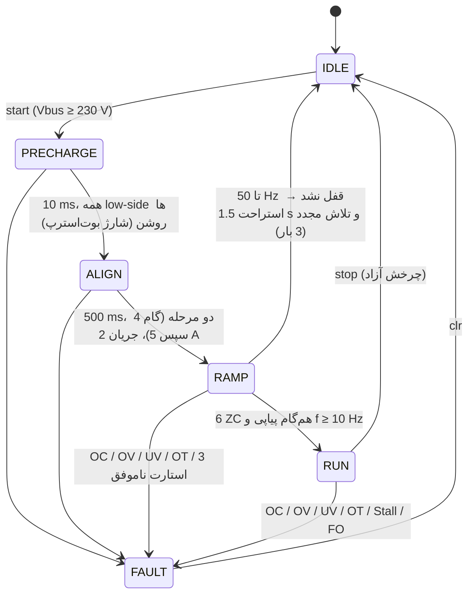
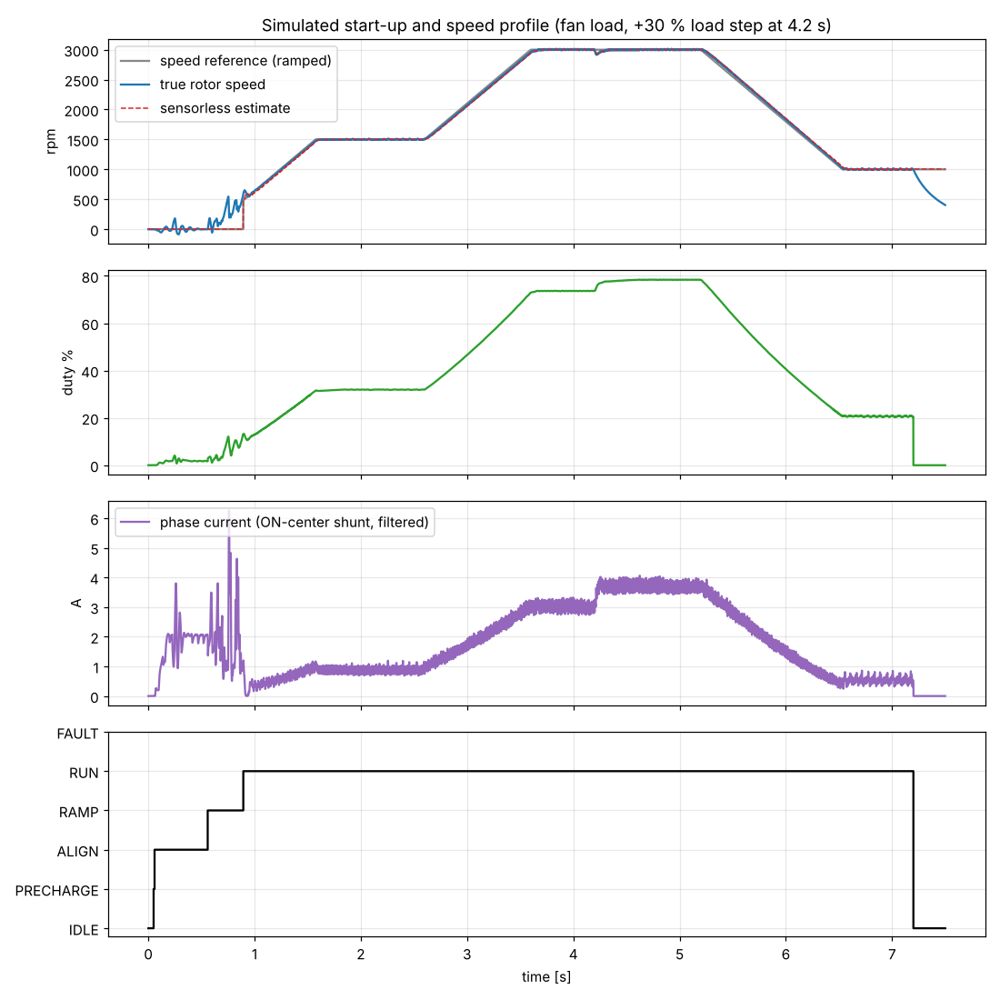
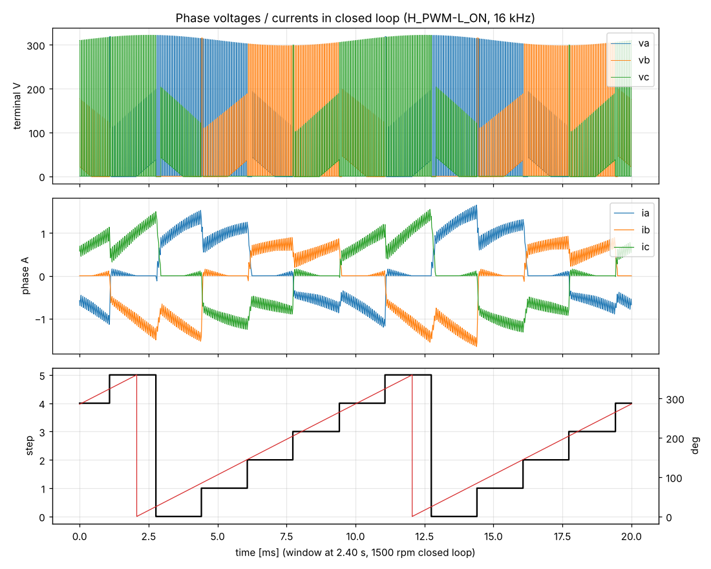

# ۲ — طراحی فریمور (Sensorless six-step روی STM32G431)

## ۲.۱ ساختار

```
firmware/
├── inc/app_config.h      همه پارامترهای سخت‌افزار و تیونینگ (یک جا)
├── core/sixstep.[ch]     هسته کنترل — C99 خالص، بدون دسترسی به رجیستر (روی PC هم کامپایل می‌شود)
├── bsp/bsp_stm32g431.c   درایورهای رجیستری (CMSIS، بدون HAL): TIM1/TIM2/ADC/OPAMP/COMP/DAC/USART/IWDG
├── app/main.c            وقفه‌ها، پیش‌شارژ باس، دکمه/پتانسیومتر، خط فرمان UART، تله‌متری
├── sim/motor_sim.c       شبیه‌ساز مدار بسته: همان هسته در برابر مدل سوئیچینگ IPM + موتور
├── sim/sweep.py, plot.py مقاوم‌سازی استارت و رسم نمودار
└── Makefile              make | make test | make sweep | make plots | make flash
```

**اصل طراحی:** هسته کنترل فقط از طریق جدول توابع `ss_hal_t` با سخت‌افزار حرف می‌زند. همین کد بدون تغییر در
شبیه‌ساز اجرا و تست می‌شود؛ پس الگوریتم قبل از اولین روشن‌کردن برد (و بدون خطر انفجار IPM) دیباگ شده است.

## ۲.۲ زمان‌بندی وقفه‌ها

| منبع | نرخ | اولویت | کار |
|---|---|---|---|
| TIM1 Break (FO از IPM) | رویداد | 0 | سخت‌افزار MOE=0 کرده؛ ثبت خطا |
| ADC1 JEOS (تریگر TIM1) | 16 kHz | 1 | `ss_on_adc`: OC/OV سریع، تشخیص ZC، تایم‌اوت |
| TIM2 CC1 (تایمر کموتاسیون) | 6×f_elec | 1 | `ss_on_comm_timer`: اعمال گام بعدی |
| SysTick | 1 kHz | 2 | `ss_tick_1ms`: ماشین حالت، حلقه سرعت، UV |
| USART1 RX | رویداد | 3 | بافر حلقوی |
| حلقه اصلی | — | — | 10 Hz دما/پتانسیومتر، 5 Hz تله‌متری، watchdog |

ADC و تایمر کموتاسیون **هم‌اولویت‌اند** تا همدیگر را قطع نکنند (حذف race روی وضعیت ZC).

## ۲.۳ PWM، کموتاسیون و نقطه نمونه‌برداری

* TIM1 مرکز-تراز (center-aligned) 16 kHz، `ARR = 5312`، dead-time 1 µs (+ اینترلاک IPM).
* **H_PWM-L_ON سنکرون:** فاز «بالا» PWM مکمل؛ فاز «پایین» low-side دائم روشن؛ فاز سوم شناور.
* بیت‌های `CCxE/CCxNE/OCxM` با `CCPC=1` پیش‌بارگذاری و با `COMG` هر سه پایه هم‌زمان عوض می‌شوند.
* فاز شناور: هر دو خروجی غیرفعال؛ سطح ورودی IPM با مقاومت pull برد تعیین می‌شود.

| جدول گام | High (PWM) | Low (ON) | شناور | شیب BEMF |
|---|---|---|---|---|
| 0 | A | B | C | نزولی |
| 1 | A | C | B | صعودی |
| 2 | B | C | A | نزولی |
| 3 | B | A | C | صعودی |
| 4 | C | A | B | نزولی |
| 5 | C | B | A | صعودی |

جهت معکوس = جابجایی نگاشت فیزیکی V و W (`map[]`).

**دو مد نمونه‌برداری BEMF** (ADC1، تریگر TRGO2 = OC6REF):

| مد | زمان نمونه | ولتاژ فاز شناور | آستانه ZC | کِی |
|---|---|---|---|---|
| ON-center | وسط بازه ON | `e + Vbus/2` | `Vbus/2` (هم‌زمان اندازه‌گیری شده) | دیوتی ≥ 30 % |
| OFF-center | وسط بازه OFF | `e` | ≈ 0 (18 count ≈ 2 V) | دیوتی ≤ 22 % |

هیسترزیس 22–30 % از نوسان بین مدها جلوگیری می‌کند. ADC2 (جریان) همیشه وسط ON (TIM1_CH4).

## ۲.۴ تشخیص عبور از صفر (ZC)

1. **Blanking:** پس از هر کموتاسیون 15 % از T60 (حداقل 80 µs) نادیده گرفته می‌شود (نویز سوئیچینگ).
2. **Arming:** دیماگنتیزه شدن فاز تازه شناور، آن را به یکی از ریل‌ها می‌چسباند — **همیشه در سمت بعد از
   عبور**. پس تشخیص فقط وقتی مسلح می‌شود که حداقل یک نمونه در سمت **قبل از عبور** دیده شود. این ترفند پالس
   دیماگ را بدون نیاز به دانستن طول آن حذف می‌کند.
3. **درون‌یابی:** زمان ZC بین دو نمونه به‌صورت خطی تخمین زده می‌شود (دقت زیر یک دوره PWM).
4. **ZC پنهان زیر دیماگ (بار سنگین):** اگر بدون دیدن سمت قبل، دو نمونه پیاپی در سمت بعد ولی **نه چسبیده به ریل**
   دیده شود ⇒ ZC قبلاً رخ داده؛ کموتاسیون فوری. (دو نمونه لازم است چون درست بعد از پایان دیماگ فیلتر RC
   هنوز در حال بالا آمدن است — این باگ را شبیه‌ساز پیدا کرد.)
5. **کموتاسیون:** `t_comm = t_zc + T60·(30° − advance)/60° − 4 µs`؛ advance = 4° + 1.5°/A (حداکثر 20°)
   برای جبران تأخیر جریان و دیماگ.
6. **تایم‌اوت:** اگر تا 2×T60 ZC دیده نشد، کموتاسیون اجباری؛ 6 بار پیاپی ⇒ خطای Stall.

## ۲.۵ ماشین حالت و استارت



* **Align دو مرحله‌ای:** یک بردار تنها برای روتوری که 180° دورتر است گشتاور صفر دارد (نقطه مرده).
* **کنترل جریان در Align/Ramp:** دیوتی = پیش‌خور BEMF (`RAMP_V_PER_HZ·f/Vbus`) + انتگرال‌گیر روی جریان فاز.
  گشتاور استارت مستقل از R، Ke و ولتاژ شبکه.
* **هم‌گام‌سازی با ZC از 8 Hz:** وقتی ZC واقعی دیده شد، کموتاسیون همان گام به `ZC+30°` منتقل می‌شود
  (روتور عقب‌مانده ⇒ میدان صبر می‌کند و pull-out نمی‌شود). در گام‌های صعودی، «روتور جلوتر» هم تشخیص داده و
  فوراً کموتاسیون می‌شود.
* **حلقه سرعت (1 kHz):** PI با `Kp = 2e-4`، `Ki = 8e-3` (دیوتی بر rpm)؛ رمپ مرجع 1500 rpm/s؛
  محدودکننده جریان (انتگرال‌گیر را پایین می‌کشد)؛ در ترمز اگر Vbus > 380 V کاهش دیوتی متوقف می‌شود.

## ۲.۶ نتایج شبیه‌سازی (قابل تکرار با `make test` و `make sweep`)

موتور مدل: 4 جفت قطب، R = 1.5 Ω، L = 8 mH، Ke = 0.573 V·s/rad (60 V/krpm)، J = 6e-4 kg·m²، بار فن (2 N·m در
3000 rpm)؛ باس 310 V با ریپل 100 Hz ±12 V؛ نویز ADC ±2 LSB؛ گام زمانی 0.25 µs؛ سوئیچینگ واقعی، دیود‌ها، دیماگ.




| سناریو | رسیدن به حلقه بسته | بیشترین خطای سرعت ماندگار (4 پنجره) | کموتاسیون اجباری |
|---|---|---|---|
| default (پروفیل 1500→3000→بار +30 %→1000 rpm) | 0.89 s | ≤ 0.07 % | 0 |
| heavy (بار +60 %) | 0.89 s | ≤ 0.06 % | 0 |
| reverse | 0.93 s | ≤ 0.07 % | 0 |
| inertia (اینرسی ×8) | 0.85 s | ≤ 0.05 % | 0 |
| lowbus (باس 250 V، ریپل ±30 V) | 0.89 s | ≤ 0.37 % (3000 rpm زیر بار، نزدیک سقف ولتاژ) | 0 |

**مقاوم‌سازی استارت (`make sweep`):** 5 سناریو × 12 زاویه اولیه روتور ⇒ **59/60 موفق** (تنها خطا: اینرسی ×8 در
یک زاویه خاص — روی سخت‌افزار با تلاش مجدد خودکار جبران می‌شود).

**مطالعه تلرانس موتور (`python3 sim/sweep.py --tolerance`):** R ×0.7…1.3، L ×0.6…1.4، Ke ×0.85…1.15 ⇒
**127/162 موفق (78 %)**. خطاها عمدتاً: (الف) استارت با اینرسی بالا + Ke کم، (ب) از دست دادن سنکرون در 3000 rpm
با L بزرگ‌تر و بار سنگین (منطقه محدود به دیماگ). **نتیجه عملی:** پارامترهای `ALIGN_*`، `RAMP_*` و
`COMM_ADV_*` باید برای هر موتور تنظیم شوند — دقیقاً با همین شبیه‌ساز (پارامترهای R/L/Ke/J موتور خودتان را در
`sim/motor_sim.c` بگذارید).

## ۲.۷ راهنمای تیونینگ برای موتور جدید

1. Ke را اندازه بگیرید: موتور را با دست/موتور دیگر بچرخانید و ولتاژ قله خط-خط و فرکانس را با اسیلوسکوپ بخوانید.
   `Ke_LL = Vpk_LL / ω_mech`. R و L را با LCR متر (بین دو فاز ÷ 2).
2. مقادیر را در `sim/motor_sim.c` بگذارید، `make test && make sweep`.
3. `RAMP_V_PER_HZ ≈ 0.9 × Ke_LL × 2π / POLE_PAIRS` (ولت بر هرتز الکتریکی).
4. `RAMP_I_A`: حدود 40–60 % جریان نامی. زیاد ⇒ نوسان روتور در بار سبک؛ کم ⇒ عقب ماندن با اینرسی بالا.
5. `RAMP_ACC_HZ_S`: با اینرسی بار تنظیم کنید؛ قاعده: گشتاور شتاب‌گیری ≤ 30 % گشتاور `RAMP_I_A`.
6. اگر در سرعت بالا و بار سنگین «demag-hidden ZCs» زیاد یا کموتاسیون اجباری دیدید ⇒ `COMM_ADV_DEG_PER_A` را بالا ببرید.
7. `SPEED_KP/KI` را با پاسخ پله در شبیه‌ساز، سپس روی سخت‌افزار تأیید کنید.

## ۲.۸ مواردی که روی سخت‌افزار باید تأیید شوند (VERIFY)

کدهای رجیستری با هدر رسمی CMSIS کامپایل شده‌اند (بدون هشدار با `-Wall -Wextra -Wdouble-promotion`) ولی
این کدگذاری‌ها را با نسخه RM0440 خودتان مطابقت دهید (در کد با `VERIFY` علامت خورده‌اند):

* `JEXTSEL` تریگر تزریقی: TIM1_TRGO2 = 8، TIM1_CH4 = 1
* `MMS2 = 1001` (OC6REF → TRGO2)
* `TIM1_AF2.OCRSEL = 001` (COMP2 → OCREF_CLR)
* `COMP2.INMSEL = 100` (DAC3_CH2)، کانال ADC2_IN16 = VOPAMP2
* پلاریته ورودی‌های IPM (`IPM_HIN_ACTIVE_LOW`, `IPM_LIN_ACTIVE_LOW`)
