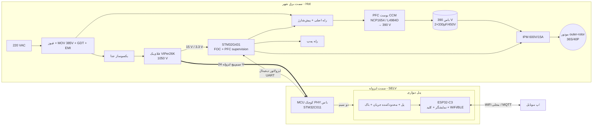

# ۴ — درایو موتور کولر آبی (8000 تا 11000): معماری نسخه ۲

این سند طراحی بخش‌های ۱ تا ۳ را برای کاربرد واقعی بازنگری می‌کند: موتور Direct-drive با شفت ثابت و
بدنه گردان (outer rotor) که مستقیم به حلزونی متصل است، پنل فرمان دوسیمه (تغذیه + دیتا روی DC)، وای‌فای و
کنترل با موبایل، شناسایی خودکار موتور، مصرف پایین و مقاومت در برابر نوسانات برق و قفل‌شدن موتور.

## ۴.۱ موتورهای فعلی — آنچه از عکس‌ها درآمد

| مورد | داده | منبع |
|---|---|---|
| موتور اول (پلاک فارسی) | Vin 220 V، Pin 1200 W، Pout 1100 W، 450 rpm، 4.5 A، راندمان 92 % | پلاک |
| SIZO ZQ200-1R22451 | 1200 W، 3 فاز 220 V، 450 rpm، In 6 A، کلاس F، راندمان 92 % | پلاک |
| استاتور outer-rotor (عکس پنجم) | **36 شیار، 40 آهنربا ⇒ 36S/40P، 20 جفت قطب** | شمارش با تبدیل قطبی + FFT روی عکس (پیک دقیقاً در 36 و 40) |
| موتور قدیمی (عکس ششم و هفتم) | 12 دندانه (قطب‌ها در عکس دیده نمی‌شوند؛ معمولاً 10 یا 14) | شمارش روی عکس |
| دو استاتور متراکم (عکس هشتم و نهم) | حدود 36 تا 48 شیار — عکس مایل است، شمارش قابل‌اعتماد نیست | — |
| بنچ تست شما | 220 V، 2.66 A، **PF = 1.00**، 593 W، دبی 6175 m³/h | نرم‌افزار تست |

**نتایج مهم:**

* گشتاور نامی: `1100 W / (450 rpm × 2π/60) ≈ 23 N·m`، یعنی موتور کم‌دور و پرگشتاور. فرکانس الکتریکی در
  450 rpm با 20 جفت قطب برابر `450 × 20 / 60 = 150 Hz` است.
* **درایو فعلی بازار PFC دارد** (PF = 1.00 و VA ≈ W). بدون PFC همان 593 W حدود **4.5 A** از شبکه می‌کشد، نه
  2.66 A. پس «مصرف جریان پایین» در عمل یعنی **PFC فعال**. این اولین تغییر نسبت به نسخه ۱ است.
* توان پلاک (1200 W) حداکثر است. نقطه کار واقعی کولر در بنچ شما حدود 600 W است. درایو برای 1.3 kW
  ورودی طراحی می‌شود و بازده آن در 30 تا 60 % بار باید بهینه باشد.

## ۴.۲ تعداد قطب — پیشنهاد من

**برای موتورهای فعلی:** درایو باید `POLE_PAIRS` را بداند **فقط برای نمایش rpm**. کنترل در فرکانس
الکتریکی کار می‌کند و تنظیم سرعت بر حسب درصد (یا پله ۱ تا ۱۰) است، پس اشتباه در تعداد قطب موتور را
نمی‌سوزاند. در بخش ۴.۵ توضیح داده‌ام که چطور خودکار شناخته می‌شود.

**اگر خودتان موتور طراحی کنید:** همان **36 شیار / 40 قطب** را نگه دارید:

| ترکیب | ضریب سیم‌پیچی | LCM (کاگینگ کمتر ⇐ بزرگ‌تر) | f_e در 450 rpm | نظر |
|---|---|---|---|---|
| **36S/40P** | 0.945 | 360 | 150 Hz | متقارن (GCD=4، نیروی شعاعی متعادل)، کاگینگ بسیار کم، BEMF تقریباً سینوسی ⇒ **مناسب FOC و کم‌صدا** |
| 36S/32P | 0.945 | 288 | 120 Hz | تلفات آهن کمتر، کاگینگ کمی بیشتر |
| 24S/28P | 0.933 | 168 | 105 Hz | سیم‌پیچی ارزان‌تر (24 کویل)، ریپل بیشتر |
| 12S/14P | 0.933 | 84 | 52 Hz | برای قطر کوچک؛ در 23 N·m حجم مس زیاد می‌شود |

درایو جدید تا **30 جفت قطب و 400 Hz الکتریکی** را پشتیبانی می‌کند (با PWM 16 kHz حداقل 40 نمونه در هر سیکل).

## ۴.۳ تغییرات کلیدی نسبت به نسخه ۱

| موضوع | نسخه ۱ | نسخه ۲ (کولر) | دلیل |
|---|---|---|---|
| ورودی | پل + خازن (PF ≈ 0.6) | **PFC فعال CCM** (باس 390 V) | جریان شبکه 40 % کمتر؛ هم‌سطح محصولات بازار؛ باس ثابت در نوسان برق |
| کنترل موتور | Six-step | **FOC بدون سنسور** (observer شار + PLL) | 36S/40P بک‌EMF سینوسی دارد. FOC ⇐ 2 تا 5 % بازده بیشتر، **صدای کمتر** (موتور روی بدنه کولر است)، استارت قوی‌تر با اینرسی بالای حلزونی |
| شناسایی موتور | دستی | **خودکار**: R، Ld/Lq، شار، اینرسی + تطبیق با کتابخانه | پشتیبانی همه مدل‌ها |
| تغذیه کمکی | باک غیرایزوله | **فلای‌بک ایزوله 1050 V** (VIPer26K) با دو خروجی | تحمل 440 VAC؛ تغذیه SELV پنل |
| رابط کاربر | UART ایزوله | **باس دوسیمه ایزوله** (تغذیه + دیتا، **Modbus RTU**) | سیم‌کشی فعلی کولر؛ ابزار تست استاندارد |
| وای‌فای | — | **ESP32-C3 در پنل** | پنل خشک و داخل خانه است؛ درایو روی پشت‌بام و مرطوب |
| حفاظت ورودی | فیوز + MOV | **رله قطع ورودی + پنجره ولتاژ + MOV 385 V + GDT** | قطع نول در ساختمان سه‌فاز (تا 380 تا 440 V) |
| خروجی‌های جانبی | — | **رله پمپ آب** (+ یک خروجی کمکی) | «سایر موارد کنترلی» کولر |

## ۴.۴ بلوک دیاگرام

## ۴.۵ شناسایی خودکار موتور

در اولین روشن‌شدن (و با فرمان `IDENTIFY` از پنل یا اپ) درایو این مراحل را اجرا می‌کند. موتور در مراحل
۱ تا ۳ تقریباً نمی‌چرخد:

| مرحله | روش | خروجی | زمان |
|---|---|---|---|
| ۰. بررسی اتصال | پالس ولتاژ کوتاه روی هر جفت فاز | قطع فاز / اتصال کوتاه ⇒ آلارم E7 | 50 ms |
| ۱. مقاومت | تزریق DC در دو سطح جریان، تفاضل ولتاژ (حذف خطای dead-time) | R (و دمای سیم‌پیچ نسبت به مقدار مرجع) | 1 s |
| ۲. اندوکتانس | پله ولتاژ و شیب جریان در زوایای مختلف | Ld، Lq (برجستگی) | 0.5 s |
| ۳. زاویه اولیه روتور | تزریق فرکانس بالا یا پالس‌های اشباع (پاسخ اندوکتانس به زاویه) | زاویه و قطب شمال/جنوب ⇒ **استارت بدون تکان و بدون Align** | 50 ms |
| ۴. شار مغناطیسی (Ke) | چرخش I/f آرام با جریان کم، سپس اندازه‌گیری ولتاژ observer | ψ (V·s/rad الکتریکی) | 5–10 s |
| ۵. اینرسی و اصطکاک | پله گشتاور و اندازه‌گیری شتاب، سپس شیب کاهش سرعت آزاد | J، B ⇒ تنظیم خودکار PI سرعت و شتاب | 5–15 s |
| ۶. حداکثر سرعت | افزایش تدریجی تا حد ولتاژ یا توان نامی | سقف 100 % سرعت | اختیاری |

**تعداد قطب و مدل موتور:** از (R، L، ψ) یک «اثر انگشت» ساخته و با **کتابخانه موتورهای شناخته‌شده**
(ELECTROGEN، SIZO و موتورهای بعدی شما) مقایسه می‌شود. اگر تطبیق پیدا شد، تعداد قطب، جریان نامی و سرعت
نامی از کتابخانه خوانده می‌شود. اگر پیدا نشد، پروفایل محافظه‌کارانه اعمال می‌شود (جریان از روی R و ψ
محدود می‌شود و سرعت بر حسب درصد است) و پنل «موتور ناشناخته» نشان می‌دهد.

> **محدودیت فیزیکی:** تعداد جفت قطب را بدون سنسور مکانیکی نمی‌توان مستقیم اندازه گرفت (درایو فقط زاویه
> الکتریکی را می‌بیند). برای موتور ناشناخته یک بار در کارخانه با تاکومتر نوری rpm را بخوانید و در کتابخانه
> ثبت کنید. برای کنترل کولر این عدد لازم نیست.

**حفاظت حرارتی بدون سنسور:** مقاومت سیم‌پیچ قبل از هر استارت اندازه گرفته می‌شود. ضریب دمایی مس
0.393 %/K است، پس `T = T_ref + (R/R_ref − 1)/0.00393`. در حین کار یک مدل I²t این دما را دنبال می‌کند.
با این روش موتور کلاس F (155 °C) بدون سنسور دما از سوختن محافظت می‌شود.

## ۴.۶ حفاظت‌ها و آلارم‌ها

| کد پنل | رویداد | تشخیص | واکنش |
|---|---|---|---|
| E1 | ولتاژ ورودی زیاد | Vin rms > 280 V (قطع در کمتر از 10 ms روی قله) | باز کردن رله ورودی، ادامه کار وقتی Vin < 265 V به مدت 5 s |
| E2 | ولتاژ ورودی کم | Vin < 150 V ⇒ کاهش توان؛ Vin < 130 V ⇒ توقف | راه‌اندازی خودکار بعد از برگشت برق |
| E3 | اتصال کوتاه / جریان زیاد | قطع سخت‌افزاری IPM (CIN) + COMP سیکل‌به‌سیکل | توقف فوری؛ 3 بار تلاش با فاصله 10 s، سپس قفل تا ریست |
| E4 | **قفل شدن موتور** | observer: جریان در حد مجاز ولی سرعت کمتر از 5 % برای 2 s، یا عدم همگرایی observer | توقف؛ 3 تلاش (10 s، 30 s، 60 s)، سپس آلارم دائم. **موتور گرم نمی‌شود** چون جریان قفل محدود است و زمان کوتاه |
| E5 | داغ شدن موتور | تخمین دما از R و I²t | کاهش دور از 130 °C، توقف در 150 °C |
| E6 | داغ شدن درایو | NTC هیت‌سینک | کاهش دور از 85 °C، توقف در 100 °C |
| E7 | قطع فاز / موتور وصل نیست / خرابی استارت | مرحله ۰ شناسایی، عدم تعادل جریان سه فاز | توقف |
| E8 | قطع ارتباط پنل | بیشتر از 60 s بدون فریم معتبر | توقف فن و پمپ (کولر بدون کنترل کار نکند) |
| E9 | خطای PFC / ولتاژ باس | OV یا UV باس، خطای کنترلر PFC | توقف |
| — | چرخش در اثر باد (windmilling) | اندازه‌گیری BEMF با خروجی‌های خاموش (همان تقسیم‌کننده‌های نسخه ۱) | چرخش موافق: گرفتن در حال حرکت (catch-on-fly)؛ چرخش مخالف: ترمز نرم تا توقف، سپس استارت |

همه آلارم‌ها با زمان و مقادیر لحظه‌ای در حافظه درایو (۳۲ رکورد آخر) ذخیره و از طریق Modbus و اپ قابل
خواندن‌اند.

## ۴.۷ مقاومت در برابر نوسانات برق

1. **قطع نول در ساختمان سه‌فاز** (ولتاژ تا 380 تا 440 VAC به مدت طولانی):
   * تغذیه کمکی با VIPer26K (MOSFET 1050 V) از یکسوساز جداگانه تغذیه می‌شود و در 440 VAC هم کار می‌کند.
   * خازن‌های باس **فقط از طریق رله‌ها** به شبکه وصل‌اند (پیش‌شارژ با مقاومت + رله اصلی). MCU قبل از بستن
     رله‌ها Vin را اندازه می‌گیرد. اگر حین کار OV شود، رله در همان نیم‌سیکل باز می‌شود و باس 390 V می‌ماند.
   * MOV نوع **S14K385** (MOV 275 V در 440 VAC دائم می‌سوزد) + GDT بین خط و PE + فیوز حرارتی روی MOV.
   * پل یکسوساز 1000 V، رله با کنتاکت 400 VAC.
2. **افت ولتاژ (برق تابستان، 150 تا 180 V):** PFC باس را در 390 V ثابت نگه می‌دارد، پس موتور همان دور را
   دارد. محدود کردن جریان ورودی به 8 A rms باعث کاهش خودکار توان (و در نتیجه دور) می‌شود.
3. **قطع و وصل سریع برق:** وقتی برق برمی‌گردد و موتور هنوز با اینرسی حلزونی می‌چرخد، catch-on-fly بدون
   ضربه موتور را می‌گیرد. حالت آخر در EEPROM ذخیره می‌شود (روشن ماندن بعد از برق).
4. **سرج و صاعقه:** MOV + GDT در ورودی AC؛ روی کابل پنل TVS + PTC ریست‌شونده (کابل پنل طولانی و بیرونی است).

## ۴.۸ مصرف پایین

| حالت | هدف | روش |
|---|---|---|
| کار در 600 W (نقطه بنچ شما) | ≥ 92 % بازده درایو، PF ≥ 0.98 | PFC CCM، FOC، IPM با تلفات پایین، PWM 16 kHz |
| بار کم (پله ۱ و ۲) | PF ≥ 0.9 | PFC در حالت burst یا خاموش زیر 80 W |
| آماده‌به‌کار (پنل و وای‌فای روشن، موتور خاموش) | **≤ 1 W کل** | خاموش کردن PFC و تغذیه 15 V گیت IPM، VIPer در burst، ESP32 در modem-sleep |

> حدود دقیق برچسب انرژی ملی کولر و الزامات «آماده‌به‌کار شبکه‌ای» را قبل از نهایی کردن هدف‌ها با استاندارد
> فعلی تطبیق دهید. من عدد استاندارد را از حافظه نقل نمی‌کنم.

## ۴.۸.۱ محیط کولر

کولر آبی رطوبت نزدیک به 100 % و قطرات آب دارد:

* برد درایو با **پوشش محافظ (conformal coating)** و جعبه **IP54**، در بخش خشک کولر نصب شود.
* هیت‌سینک خارج از جعبه یا در مسیر هوای ورودی (قبل از پوشال)، با واشر آب‌بند.
* گلند کابل برای سیم موتور و پنل.

## ۴.۹ باس دوسیمه پنل (لایه فیزیکی)

| پارامتر | مقدار |
|---|---|
| ایزولاسیون | سیم‌پیچ جداگانه فلای‌بک با عایق تقویت‌شده؛ کل باس SELV است |
| ولتاژ | 24 V در حالت mark/idle، **16 V** در حالت space (درایو ⇒ پنل، مدولاسیون ولتاژ) |
| پنل ⇒ درایو | مدولاسیون جریان: **+20 mA** روی جریان پایه پنل |
| تشخیص در درایو | MCU کوچک سمت SELV (STM32C011) جریان را با ADC می‌خواند و آستانه را با جریان idle تطبیق می‌دهد (مثل M-Bus) |
| سرعت | 2400 bps، 8N1، نیم‌دوطرفه |
| پروتکل | **Modbus RTU** (پنل master، درایو slave با آدرس 1) — سند `05_panel_bus_modbus.md` |
| توان قابل دریافت پنل | ≤ 80 mA پیوسته (≈ 1.9 W)؛ محدودیت جریان اتصال کوتاه 150 mA |
| کابل | دو رشته 0.5 mm² تا 50 m، **بدون حساسیت به پلاریته** (پل دیود در پنل) |
| حفاظت | TVS 33 V + PTC 200 mA در دو طرف |

**چرا Modbus RTU:** نرم‌افزار بنچ تست شما (ارتباط سریال) و هر ابزار PC (مثل Modbus Poll) بدون پنل مستقیم
به درایو وصل می‌شوند و توان، دور، آلارم و شناسایی را می‌خوانند. برای ESP32 هم کتابخانه `esp-modbus` آماده است.
**اگر باید با پنل‌های موجود بازار سازگار باشید**، یک ضبط از سیگنال و پروتکل آن پنل را بفرستید تا PHY و
پروتکل را مطابق آن کنم.

## ۴.۱۰ پنل و موبایل

* **ESP32-C3** (Wi-Fi 4 + BLE 5، RISC-V، ارزان) در پنل. اگر Matter/Thread مد نظر است، ESP32-C6.
* **راه‌اندازی اولیه:** BLE provisioning (اپ رمز وای‌فای را می‌دهد).
* **کنترل محلی بدون اینترنت** (اولویت اول، چون اینترنت ممکن است قطع یا محدود شود): mDNS + WebSocket روی
  شبکه خانه؛ در نبود روتر، BLE مستقیم.
* **کنترل از راه دور (اختیاری):** MQTT روی TLS به سرور خودتان.
* **به‌روزرسانی OTA:** پنل از اینترنت؛ **فریمور درایو هم از طریق پنل** (بوت‌لودر Modbus در درایو، با
  امضا و دو بانک حافظه).
* قابلیت‌های اپ: روشن/خاموش، دور (۱۰ پله یا درصد)، پمپ، تایمر و برنامه هفتگی، حالت «فقط پمپ» (پیش‌خیس
  کردن پوشال)، نمایش مصرف لحظه‌ای و kWh، آلارم با نوتیفیکیشن، تاریخچه خطاها، شناسایی موتور.
* منطق کاربردی کولر در پنل: پیش‌خیس کردن پوشال (پمپ 2 دقیقه قبل از فن)، خشک کردن پوشال قبل از خاموشی
  (فن 5 دقیقه بعد از قطع پمپ برای جلوگیری از بو و کپک)، ورودی سنسور دما و رطوبت برای حالت خودکار.

## ۴.۱۱ ابعاد و جریان‌های طبقه قدرت (1.3 kW ورودی)

| کمیت | مقدار |
|---|---|
| جریان ورودی در 180 VAC و 1300 W، PF 0.99 | ≈ 7.3 A rms ⇒ فیوز 10 A T، چوک PFC ≈ 400 µH / 12 A peak |
| باس | 390 V؛ خازن 2×330 µF / 450 V (ریپل 100 Hz با PFC ≈ 15 V p-p در 1.2 kW) |
| جریان فاز موتور | 3.3 A rms نامی (1200 W، 220 V خط، cosφ 0.95)؛ پلاک تا 6 A ⇒ IPM 15 A کافی است؛ حد جریان 12 A پیک |
| IPM | همان STGIB15CH60TS-L (یا IKCM15L60GD). در FOC هر سه پایه سوئیچ می‌کنند ⇒ تلفات IPM ≈ 15 W در 1.2 kW |
| PFC | MOSFET 650 V (≈ 100 mΩ)، دیود SiC 650 V 6 A، تلفات ≈ 12 W |
| هیت‌سینک مشترک | ≤ 1.2 K/W برای کل حدود 35 W (IPM + PFC + پل) |

## ۴.۱۲ وضعیت فعلی و برنامه کار

| مرحله | وضعیت |
|---|---|
| تحلیل موتورها، معماری، حفاظت، باس پنل | ✅ این سند |
| پروتکل Modbus (نقشه رجیستر + کد slave در C + تست) | ✅ `05_panel_bus_modbus.md`، `firmware/comm/` |
| هسته six-step + شبیه‌ساز (نسخه ۱) | ✅ برای تست اولیه سخت‌افزار و موتورهای BEMF ذوزنقه‌ای قابل استفاده است |
| هسته FOC بدون سنسور + شناسایی خودکار + شبیه‌ساز موتور سینوسی | ✅ `06_foc_sensorless.md` — 110/110 موتور تصادفی در شبیه‌سازی |
| شماتیک PFC، فلای‌بک، PHY باس و پنل | ⏳ بعد از تأیید معماری |
| فریمور پنل ESP32-C3 و اپ | ⏳ |

**برای گام بعد از شما لازم است:**

1. ~~تأیید PFC و FOC~~ ✅ تأیید شد.
2. برای هر مدل موتور (حداقل SIZO و ELECTROGEN):
   * مقاومت بین دو فاز با میلی‌اهم‌متر،
   * اندوکتانس بین دو فاز با LCR در 1 kHz،
   * ولتاژ BEMF خط-خط وقتی موتور را با دست یا دریل می‌چرخانید (شکل موج اسیلوسکوپ + فرکانس + rpm).

   با این داده‌ها شبیه‌ساز را دقیقاً روی موتورهای شما تنظیم می‌کنم.
3. اینرسی حلزونی (یا وزن و قطرش) و منحنی توان-دور از بنچ تست شما در چند پله سرعت.
4. آیا پنل باید با پنل‌های موجود بازار سازگار باشد یا پنل را هم خودتان می‌سازید؟
