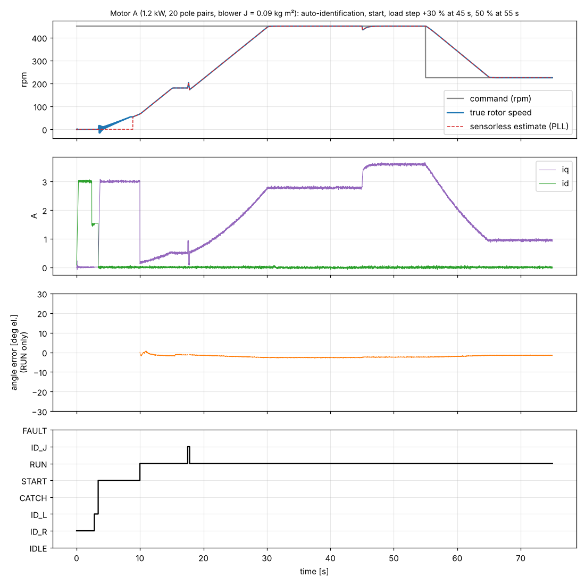
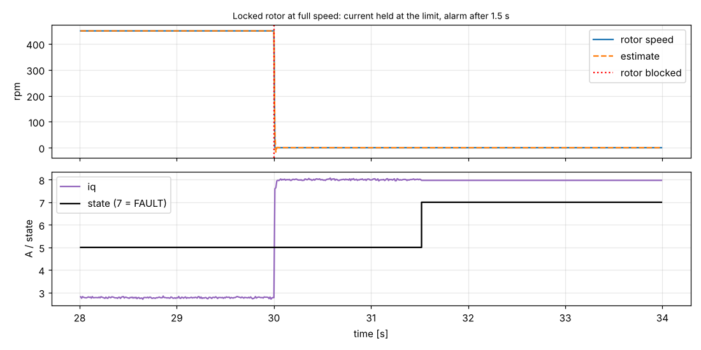

# ۶ — FOC بدون سنسور و شناسایی خودکار موتور (نسخه کولر)

کد: `firmware/foc/foc.[ch]` (هسته قابل حمل، C99، فقط float تک‌دقت، حدود 7.4 KB روی Cortex-M4F)
شبیه‌ساز و تست‌ها: `firmware/foc/foc_sim.c` — `make test-foc`، `make test-foc-random`، `make plots-foc`

## ۶.۱ ساختار کنترل

```mermaid
flowchart LR
  ADC[3 شنت\nia ib ic] --> REC[بازسازی جریان\n+ پیش‌بینی وقتی دو پنجره کوتاه است]
  REC --> CL[Clarke/Park] --> PI[PI جریان d/q\n+ decoupling + محدودیت دایره ولتاژ]
  PI --> SV[SVPWM min-max\n+ جبران dead-time خودکالیبره]
  SV --> TIM[TIM1 → IPM]
  REC --> OBS[observer شار فعال\n(Ortega، مناسب موتور برجسته)]
  OBS --> PLL[PLL → سرعت]
  OBS -->|زاویه| CL
  PLL --> SPD[حلقه سرعت 1 kHz\nرمپ + محدودیت ولتاژ + محدودیت بازتولید انرژی]
  SPD -->|iq_ref| PI
```

| بخش | جزئیات |
|---|---|
| حلقه جریان | 16 kHz، پهنای باند 600 Hz، بهره‌ها **خودکار از R و L شناسایی‌شده** (`Kp = L·ωc`، `Ki = R·ωc`) |
| تأخیر سخت‌افزار | فرمان در دوره k+1 اعمال می‌شود؛ observer ولتاژ دو دوره قبل را استفاده می‌کند؛ زاویه مدولاسیون با `1.5·Ts·ω` پیش‌جبران می‌شود |
| Observer | `η = x − Lq·i`، قید `|η| = ψ + (Ld−Lq)·id` (شار فعال ⇒ درست برای موتور برجسته/IPM) |
| حلقه سرعت | PI با پهنای باند 2 Hz؛ **بهره‌ها از اینرسی شناسایی‌شده** (`G = 1.5ψ/Je`) |
| حداکثر سرعت خودکار | اگر ولتاژ اینورتر اشباع شود (موتور L بالا، برق کم)، مرجع سرعت به سرعتِ قابل‌دسترس برمی‌گردد — **بدون قطع** |
| بازتولید انرژی | PFC نمی‌تواند انرژی برگشتی را جذب کند ⇒ بالای 420 V گشتاور ترمزی صفر و مرجع همراه روتور (نه کمتر از هدف) |

## ۶.۲ شناسایی خودکار (بار اول، یا با رجیستر `IDENTIFY`)

| مرحله | روش | دقت در شبیه‌سازی |
|---|---|---|
| تراز روتور | جریان DC روی محور α + **میرایی فعال** (بک‌EMF محور q به‌صورت جریان مخالف) + تشخیص آرام‌شدن (حداقل 2 s، حداکثر 8 s) | — |
| R | دو سطح جریان (بالا سپس پایین)، `R = ΔV/ΔI` | ±0.2 % |
| **dead-time اینورتر** | عرض از مبدأ همان خط `V(I)` ⇒ جبران dead-time **خودکالیبره** (از هر حدس اولیه 3 تا 8 V به مقدار واقعی 6.24 V رسید) | دقیق |
| Ld, Lq | تزریق مربعی ±6 % Vbus، **حلقه باز** روی ولتاژ DC نگه‌داشته‌شده، دمدولاسیون با علامت اعمال‌شده | ±1–2 % |
| ψ (اولیه) | انتگرال‌گیر نشتی `v − R i` در قاب ساکن حین I/f (مستقل از نوسان روتور) | ±8 % (برای handover کافی است) |
| ψ (دقیق) | در حلقه بسته، `vq = R·iq + ω·ψ`، دو مرحله | ±0.2 % |
| اینرسی Je = J/p² | پله گشتاور متقارن +ΔI/−ΔI (ΔI کمتر از جریان بار ⇒ بدون بازتولید) | ±10 % |
| حداکثر سرعت | محدودیت ولتاژ (بالا) | — |

مدت کل: حدود 20 s (بیشترش رمپ آرام حلزونی سنگین است). نتایج باید در فلش ذخیره شوند. **تعداد جفت قطب
لازم نیست** (همه‌چیز الکتریکی است؛ برای نمایش rpm از کتابخانه یا رجیستر `POLE_PAIRS`).

## ۶.۳ حفاظت‌ها در هسته

| رویداد | تشخیص | نتیجه شبیه‌سازی |
|---|---|---|
| قفل روتور در حال کار | `|ω| < 4 %` و `|iq| > 80 % حد` به مدت 1.5 s، یا ناهمخوانی شار observer | تشخیص در **1.52 s**، جریان روی حد 8 A |
| روتور گیر کرده هنگام استارت | observer تا 3 s بعد از پایان رمپ I/f تأیید نمی‌کند | خطا، جریان 3.1 A |
| موتور وصل نیست / سیم‌پیچ قطع | جریان به مرجع نمی‌رسد | `PHASE_LOSS` |
| جریان لحظه‌ای | قله > 14 A | `OVERCURRENT` (به‌علاوه CIN سخت‌افزاری IPM) |
| ولتاژ باس | > 445 V یا < 200 V | `OVERVOLT` / `UNDERVOLT` |
| چرخش با باد، موافق | کنترل جریان صفر 150 ms ⇒ observer قفل می‌کند | حلقه بسته در **0.15 s** بدون I/f |
| چرخش با باد، مخالف | صبر تا کند شدن، سپس استارت | استارت موفق |

تلاش مجدد (10/30/60 s)، کدهای E1–E9 و ذخیره تاریخچه در لایه کاربردی (`cooler_regs`) انجام می‌شود.

## ۶.۴ نتایج آزمون (همه در شبیه‌ساز)

مدل: PMSM در قاب dq با زمان‌بندی واقعی PWM و تأخیر یک دوره، dead-time وابسته به ریپل جریان، نمونه‌برداری
3 شنت با نویز و کوانتیزاسیون و پنجره حداقل 3 µs، باس PFC با 660 µF که انرژی برگشتی را جذب نمی‌کند، بار فن
`T = kf·ω² + Tc`.

| آزمون | نتیجه |
|---|---|
| ۴ موتور نمونه (SIZO-مانند، ELECTROGEN-مانند برجسته، 12S/14P قدیمی، طرح جدید) — **ناشناخته برای درایو** | شناسایی ±1 %، اینرسی ±10 %، خطای سرعت ماندگار < 0.01 %، بدون خطا |
| استارت از 8 زاویه اولیه (موتور A و B) | 8/8 و 8/8 |
| **110 موتور تصادفی** (جفت قطب 7 تا 24، R 0.6–4 Ω، L 5–35 mH، برجستگی تا 1.4، J 0.03–0.15) | **110/110** (شامل موتورهایی که باس برای سرعت کامل آن‌ها کافی نیست: محدود به سرعت، بدون قطع) |
| کاهش سرعت سریع بدون بار هوا | Vbus حداکثر 422 V، بدون خطا |




## ۶.۵ ایرادهایی که شبیه‌ساز پیدا کرد (و رفع شد)

1. تست اینرسی متقارن در بار سبک **ترمز می‌کرد** و باس PFC را تا حدود 520 V بالا می‌برد ⇒ ΔI کمتر از جریان بار.
2. در بازتولید، مرجع سرعت **از هدف هم پایین‌تر** می‌رفت تا توقف و آلارم کاذب قفل ⇒ محدود به هدف.
3. **جبران dead-time** در جریان کم (کمتر از ریپل PWM) بیش از حد بود ⇒ خطای زاویه 35° در handover ⇒ مدل
   وابسته به ریپل + کالیبراسیون خودکار.
4. اندوکتانس 8 % **بیش‌برآورد** می‌شد (جمله P کنترل‌گر جریان بخشی از ولتاژ تزریقی را خنثی می‌کرد) ⇒ تزریق حلقه‌باز.
   همین خطا باعث **لغزش آهسته زاویه observer** و شکست استارت می‌شد.
5. observer با L میانگین روی موتور برجسته در I/f همگرا نمی‌شد ⇒ observer شار فعال.
6. نزدیک مدولاسیون کامل **دو فاز** پنجره نمونه‌برداری کوتاه داشتند ⇒ پیش‌بینی جریان (قبلاً قطع اضافه‌جریان).
7. روتور سنگین در تراز **۴۰± درجه** نوسان می‌کرد و R/L غلط اندازه‌گیری می‌شد ⇒ میرایی فعال + تشخیص آرام‌شدن.

## ۶.۶ محدودیت‌ها (صادقانه)

* همه نتایج **شبیه‌سازی** است. مدل موتور خطی است (اشباع مغناطیسی، کاگینگ و تلفات آهن مدل نشده‌اند) و
  پارامترهای موتور A از روی پلاک تخمین زده شده‌اند. اندازه‌گیری‌های واقعی موتورهای شما مدل را دقیق‌تر می‌کند.
* تشخیص قطع **یک** فاز (در حین کار) هنوز پیاده نشده؛ فقط موتور قطع کامل در شناسایی تشخیص داده می‌شود.
* در حالت بازتولید، کاهش سرعت با بار خیلی سبک محدود به تلفات است (عمداً، چون PFC انرژی را جذب نمی‌کند).
* sinf/cosf/atan2f از کتابخانه است؛ روی G431 باید به **CORDIC سخت‌افزاری** منتقل شود (زمان محاسبه هنوز
  روی سخت‌افزار اندازه‌گیری نشده؛ تخمین من 10 تا 20 µs از 62.5 µs).

## ۶.۷ تغییرات سخت‌افزاری لازم نسبت به نسخه ۱

| بخش | نسخه ۱ (six-step) | نسخه ۲ (FOC) |
|---|---|---|
| اندازه‌گیری جریان | 1 شنت DC | **3 شنت** در امیترهای NU/NV/NW + OPAMP1/2/3 داخلی G431 (PGA) |
| نمونه‌برداری | ADC در مرکز ON/OFF | ADC در قله شمارنده (مرکز روشن بودن low-sideها)، هر سه فاز |
| تقسیم‌کننده‌های BEMF | برای ZC | برای اندازه‌گیری ولتاژ ورودی/باس و تشخیص چرخش قبل از روشن کردن خروجی‌ها (اختیاری) |
| ورودی | پل + خازن | PFC فعال CCM (بخش ۴) |

## ۶.۸ قدم‌های بعدی

1. شماتیک کامل نسخه ۲: PFC، فلای‌بک 1050 V، 3 شنت، PHY ایزوله باس پنل.
2. BSP برای FOC روی G431: تریگر ADC در قله، OPAMP1/2/3، CORDIC، ذخیره پارامترها در فلش، اتصال به Modbus.
3. لایه کاربردی: E1–E9، تلاش مجدد، کتابخانه موتور، مدل حرارتی موتور از R.
4. اعمال اندازه‌گیری‌های موتورهای واقعی در شبیه‌ساز.
