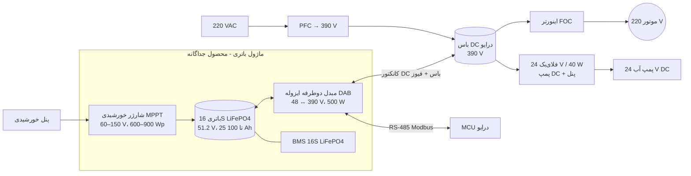

# ۷ — برق اضطراری با باتری ۴۸ ولت و ورودی خورشیدی

**تصمیم:** درایو اصلی همان درایو ۳۱۰/۳۹۰ ولت (PFC + FOC) می‌ماند و همه موتورهای ۲۲۰ ولتی را پشتیبانی می‌کند.
برق اضطراری یک **ماژول جداگانه و اختیاری** است که به باس DC درایو وصل می‌شود. مشتری بدون باتری هزینه‌ای
برای آن نمی‌دهد.

## ۷.۱ معماری

**اولویت منابع فقط با سطح ولتاژ (بدون نیاز به پیام):**

| منبع | نقطه تنظیم | رفتار |
|---|---|---|
| PFC (برق شهر) | 390 V | وقتی برق هست، ماژول نزدیک صفر جریان می‌دهد |
| ماژول باتری | 370 V | با قطع برق باس از 375 V پایین می‌آید ⇒ ماژول **در کمتر از 5 ms** وارد می‌شود (آماده‌به‌کار گرم) |
| درایو: افت ولتاژ | زیر 340 V | اگر ماژول به سقف توانش برسد، درایو توان موتور را خودش کم می‌کند (حتی بدون پیام) |
| قطع زیر ولتاژ | 200 V | آخرین حفاظت |

## ۷.۲ نتایج شبیه‌سازی (موتور A، حلزونی سنگین، ماژول 500 W)

| سناریو | دور هنگام قطع برق | توان ماژول | کمترین ولتاژ باس | برگشت برق | خطا |
|---|---|---|---|---|---|
| قطع برق در دور کامل، **بدون پیام** به درایو | 91 % (سقف توان ماژول) | 500 W | 331 V | 450 rpm | ندارد |
| قطع برق + حالت باتری (سقف دور 80 %) | 80 % | 348 W | 331 V | 450 rpm | ندارد |
| استارت فقط با باتری (بدون برق شهر) | 91 % | 500 W | 340 V | — | ندارد |
| (مقایسه) ماژول با 30 ms تأخیر ورود | 91 % | 500 W | **299 V** | — | ندارد ⇒ الزام 5 ms |

اجرا: `make test-foc` (آزمون‌های 9، 9b، 10).

## ۷.۳ زمان کارکرد با باتری

توان فن با توان سوم دور تغییر می‌کند. مبنا نقطه بنچ شما است (حدود 630 W روی باس در دور کامل، به‌علاوه
8 W مصرف داخلی). راندمان ماژول 94 % و عمق دشارژ مجاز LiFePO4 90 % فرض شده است. **پمپ DC (حدود 25 W)
جدا اضافه می‌شود.**

| دور | توان از باتری | 1.28 kWh (51.2 V 25 Ah) | 2.56 kWh (50 Ah) | 5.12 kWh (100 Ah) |
|---|---|---|---|---|
| 100 % | 680 W ⇒ ماژول 500 W کافی نیست، دور خودکار به حدود 91 % محدود می‌شود | — | — | — |
| 90 % | 497 W | 2.3 h | 4.6 h | 9.3 h |
| **80 % (پیش‌فرض باتری)** | **352 W** | **3.3 h** | **6.6 h** | **13 h** |
| 70 % | 238 W | 4.8 h | 9.7 h | 19 h |
| 60 % | 153 W | 7.5 h | 15 h | 30 h |
| 50 % | 92 W | 12.5 h | 25 h | 50 h |

برای هدف **۲ تا ۴ ساعت در دور ۷۵ تا ۸۰ %** (فرض من تا وقتی عدد دقیق را بگویید): باتری **1.28 تا 2.56 kWh**.
اپ زمان باقی‌مانده را از توان لحظه‌ای حساب می‌کند (`IR_BATT_MIN_LEFT`) و کاربر می‌بیند با کم کردن دور چقدر
زمان اضافه می‌گیرد.

## ۷.۴ مشخصات ماژول

| بخش | انتخاب | دلیل/محاسبه |
|---|---|---|
| باتری | 16S LiFePO4 (40 تا 58.4 V، نامی 51.2 V) | ایمن‌ترین شیمی لیتیوم، 3000+ سیکل، زیر 60 V (SELV) |
| BMS | 16S، جریان پیوسته ≥ 20 A، ارتباط RS-485/CAN | جریان باتری در 500 W: 10.4 A (نامی) تا 13.3 A (باتری خالی) |
| مبدل اصلی | **DAB دوطرفه** 500 W، 100 kHz، ترانس 1:8 | 390/51.2 = 7.6 ⇒ 1:8؛ یک مبدل هم دشارژ هم شارژ؛ ایزولاسیون تقویت‌شده بین باتری و باس |
| سمت باتری | پل کامل، MOSFET 100 V کم‌مقاومت (≈ 3–5 mΩ) | جریان تا حدود 14 A |
| سمت باس | پل کامل، MOSFET سوپرجانکشن 650 V یا SiC | ولتاژ 390 V، جریان حدود 1.3 A |
| راندمان | حدود 94 % (هدف) | — |
| آماده‌به‌کار | گرم، ورود ≤ 5 ms | از شبیه‌سازی (بخش ۷.۲) |
| شارژ از برق شهر | 0 تا 600 W قابل تنظیم (`HR_BATT_CHARGE_W`، پیش‌فرض 250 W) | 2.56 kWh در حدود 10 h با 250 W. شارژ فقط وقتی PFC ظرفیت آزاد دارد |
| ورودی خورشیدی | MPPT باک، Voc تا 150 V (دو پنل سری)، 600 تا 900 Wp | حدود 2.6 تا 4 kWh در روز (5.5 ساعت آفتاب مؤثر، 80 % راندمان سیستم) ⇒ **کولر روزانه چند ساعت فقط با خورشید** |
| حفاظت | فیوز DC (40 A) کنار باتری، محافظ پلاریته معکوس، پیش‌شارژ خازن‌های سمت 48 V، کلید قطع | جریان اتصال کوتاه باتری لیتیومی بسیار زیاد است |
| کانکتور باس | کانکتور DC با رتبه 450 V + فیوز 5 A + مقاومت پیش‌شارژ | اتصال به باس 390 V در جعبه درایو، فقط توسط نصاب |

## ۷.۵ پمپ آب

پمپ‌های معمول کولر 220 V AC هستند و از باس DC کار نمی‌کنند. پیشنهاد: **پمپ 24 V DC** (حدود 20 تا 30 W،
در کولرهای خورشیدی رایج است) که از یک فلای‌بک 24 V / 40 W روی **باس DC** تغذیه می‌شود. پس با برق شهر و با
باتری یکسان کار می‌کند. برای سازگاری، رله پمپ AC هم روی برد می‌ماند (فقط با برق شهر).

## ۷.۶ فریمور (انجام شد)

* هسته FOC: `foc_set_power_limit()` و **افت توان خودکار زیر 340 V** (بخش ۷.۱).
* Modbus (پروتکل نسخه 2، سازگار رو به عقب):

| رجیستر | توضیح |
|---|---|
| HR 12 `BATT_SPEED_MAX` | سقف دور در حالت باتری (پیش‌فرض 80 %) |
| HR 13 `BATT_PUMP` | پمپ روی باتری روشن بماند |
| HR 14 `BATT_RESERVE` | در این درصد شارژ فن خاموش شود تا باتری آسیب نبیند (پیش‌فرض 15 %) |
| HR 15 `BATT_CHARGE_W` | حداکثر توان شارژ از برق شهر |
| IR 22 `POWER_SOURCE` | 0 برق شهر، 1 باتری، 2 خورشید |
| IR 23 تا 28 | درصد شارژ، ولتاژ، توان باتری، زمان باقی‌مانده، توان خورشیدی، وضعیت ماژول |
| آلارم E10 / E11 | باتری به حد ذخیره رسید / خطای ماژول |

## ۷.۷ قدم‌های بعد

1. شماتیک درایو نسخه ۲ با کانکتور باس، فلای‌بک 24 V پمپ و رابط RS-485 ماژول.
2. طراحی ماژول DAB (ترانس، کنترل phase-shift، شارژ CC/CV) — پروژه جداگانه.
3. لایه کاربردی: منطق حالت باتری (سقف دور، حد ذخیره، اولویت پمپ) و برآورد زمان.
