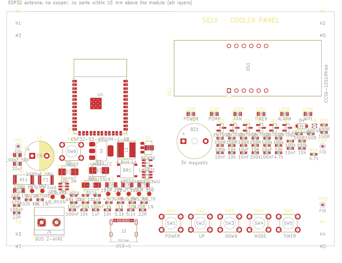

# سخت‌افزار پنل کولر — نسخه پایه (نمایشگر ۴ رقمی + کلید، Wi-Fi/BLE)

## فایل‌ها

| فایل | توضیح |
|---|---|
| [`schematic.py`](schematic.py) | منبع اصلی شماتیک (هر قطعه، پین و نت) |
| [`layout.py`](layout.py) | ابعاد برد و چیدمان |
| [`out/kicad/`](out/kicad/) | **پروژه کامل KiCad 7** (۴ برگه + برد چیده‌شده). Altium: `File → Import Wizard → KiCad` |
| [`out/cooler_panel_schematic.pdf`](out/cooler_panel_schematic.pdf)، [`out/cooler_panel_placement.pdf`](out/cooler_panel_placement.pdf) | PDF |
| [`out/bom.csv`](out/bom.csv)، [`out/netlist.md`](out/netlist.md)، [`out/cooler_panel_altium_protel.net`](out/cooler_panel_altium_protel.net) | BOM، نت‌لیست خوانا، نت‌لیست Protel/Altium |

ساخت و بررسی: `./build.sh` (از همان ابزارها و کتابخانه‌های `hardware/v2` استفاده می‌کند).

| بررسی | نتیجه |
|---|---|
| سمبل، نام پین (از جمله **همه پین‌های ESP32-S3**)، پد footprint (کتابخانه رسمی KiCad 7.0.11) | **0 خطا، 0 هشدار** (109 قطعه، 73 نت) |
| نت‌لیستی که KiCad از شماتیک رسم‌شده خروجی گرفت در برابر طراحی | **0 اختلاف** |
| نت پدهای برد در برابر طراحی | **0 اختلاف** |
| DRC | **0 خطای مسدودکننده** (باقی: اتصالات مسیرکشی‌نشده و تداخل ظاهری silkscreen) |

## برگه‌ها

| برگه | محتوا |
|---|---|
| ۱ رابط باس و تغذیه | ترمینال دوسیمه، فیوز PTC، TVS 33 V، پل ABS10 (بی‌تفاوت به پلاریته)، **منبع جریان ثابت LM317 (52 mA)**، خازن ذخیره 1000 µF با زنر 10 V، باک AP63203 به 3.3 V، **گیرنده** (مقایسه‌گر LMV331 روی ولتاژ باس)، **فرستنده** (سینک جریان 20 mA با BCX56)، دیود USB |
| ۲ ESP32-S3 | ماژول ESP32-S3-WROOM-1 (همان پردازنده نسخه تاچ آینده)، ریست، کلید BOOT، **USB-C** برای برنامه‌ریزی کارخانه و سرویس با محافظ ESD |
| ۳ نمایش و کلید | نمایشگر ۴ رقمی 0.56 اینچ (CC56-12SURKWA) + ۶ LED وضعیت در ۵ فاز مالتی‌پلکس، ۵ کلید، بازر، **سنسور دما و رطوبت SHT40 (آپشن، مونتاژ نمی‌شود)** |
| ۴ مکانیک | ۴ سوراخ M3، ۳ فیدوشیال، ۹ نقطه تست |

ابعاد برد: **112 × 80 mm**؛ نمایشگر، LEDها و کلیدها در جلو. آنتن ماژول رو به لبه بالا؛ تا 15 mm بالای ماژول
نباید مس یا قطعه باشد. قطعات SMD موقع مسیرکشی می‌توانند به پشت برد منتقل شوند.

## محاسبات رابط باس

| کمیت | مقدار | توضیح |
|---|---|---|
| جریان ورودی ثابت | 1.25 V / 24 Ω = **52 mA** | مستقل از مصرف لحظه‌ای وای‌فای ⇐ درایو تغییر جریان را با داده اشتباه نمی‌گیرد |
| جریان هنگام ارسال پنل | 52 + 20.4 = **73 mA** | زیر سقف 80 mA و محدودیت 150 mA درایو؛ پله 20 mA دو برابر آستانه 10 mA درایو |
| توان در دسترس | 10 V × 52 mA = 0.52 W ⇐ با بازده باک 85 %: **~134 mA در 3.3 V** | |
| مصرف تخمینی | وای‌فای متصل با modem-sleep ~45 mA + نمایشگر میانگین ~37 mA + بقیه ~5 mA = **~87 mA** | حاشیه دارد؛ اضافه در زنر تلف می‌شود (حداکثر 0.52 W، زنر 3 W) |
| پیک ارسال وای‌فای | ~350 mA در 3.3 V ⇐ کسری ~115 mA از خازن 1000 µF | 5 ms ارسال ⇐ افت 0.6 V. توان ارسال در فریمور به 15 dBm محدود شده |
| تلفات LM317 | (22.4 − 10 − 1.25) V × 52 mA = **0.58 W** | SOT-223 با مس کافی (حدود +35 K) |
| آستانه گیرنده | 2.354 V × 7.8 = **18.4 V** روی باس یکسوشده (mark 22.4 V، space 14.4 V) | پسماند 0.47 V |
| سینک فرستنده | (3.1 − 0.65) V / 120 Ω = **20.4 mA**؛ ترانزیستور 0.21 W، مقاومت 470 Ω: 0.2 W (2512) | TX در فریمور معکوس است (سینک روشن = space) |
| افت کابل | 50 m × 2 × 0.036 Ω/m × 73 mA = 0.26 V | قابل صرف‌نظر |
| شارژ اولیه | 1000 µF تا 10 V با 52 mA: **0.2 s** | |

## نقشه پایه‌های ESP32-S3 (همان `firmware/panel/esp32/main/ui_seg.c` و `bus_uart.c`)

| کاربرد | پایه |
|---|---|
| باس: TX / RX / ولتاژ (ADC) | IO17 / IO18 / IO1 |
| سگمنت a..g, dp | IO4، IO5، IO6، IO7، IO15، IO16، IO8، IO9 |
| رقم 1..4، فاز LEDها | IO10..IO13، IO14 |
| کلیدها POWER، ▲، ▼، MODE، TIMER | IO38..IO42 |
| بازر / I2C سنسور | IO21 / IO47 (SDA)، IO48 (SCL) |
| USB / UART کارخانه / BOOT | IO19، IO20 / RXD0، TXD0 / IO0 |
| آزاد | IO2، IO3، IO45، IO46، IO35–37 (در نسخه PSRAM هشت‌بیتی رزرو) |

## پیشنهاد جعبه و نصب

* جعبه روکار 125 × 90 mm با پنجره دودی جلوی نمایشگر و LEDها، کلیدهای ممبرین یا دکمه پلاستیکی روی کلیدهای 6 mm.
* ترمینال باس و USB در لبه پایین؛ ورود کابل از پایین (آب از بالا نفوذ نکند).
* سنسور SHT40 (اگر نصب شود) دور از رگولاتور و LM317، با شکاف در برد برای جدا کردن گرما.

## کار باقی‌مانده

مسیرکشی (دولایه، مس پهن زیر LM317 و زنر، زمین یکپارچه، بدون مس زیر آنتن)، انتخاب نهایی جعبه، و تست
روی برد: سطح سیگنال باس در طول کابل واقعی، مصرف واقعی ESP32-S3 در حالت متصل، روشنایی نمایشگر.
