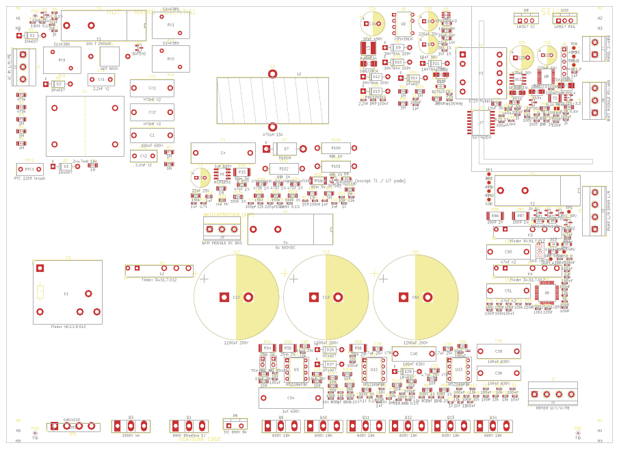

# شماتیک و چیدمان درایو کولر — نسخه ۲ (برق شهر 220 VAC)

## فایل‌های آماده برای Altium / KiCad

| فایل | توضیح |
|---|---|
| [`out/kicad/`](out/kicad/) | **پروژه کامل KiCad 7**: شماتیک ۸ برگه (+ برگه اصلی)، برد با همه قطعات چیده‌شده، net class ها، قوانین DRC، کتابخانه محلی |
| [`out/bldc_cooler_v2_schematic.pdf`](out/bldc_cooler_v2_schematic.pdf) | شماتیک PDF (۹ صفحه) |
| [`out/bldc_cooler_v2_placement.pdf`](out/bldc_cooler_v2_placement.pdf) | چیدمان برد PDF |
| [`out/bldc_cooler_v2_altium_protel.net`](out/bldc_cooler_v2_altium_protel.net) | نت‌لیست فرمت Protel/Altium (راه جایگزین) |
| [`out/bom.csv`](out/bom.csv) | لیست قطعات (ستون Populate: `yes` یا `OPTION/DNP`) |

### باز کردن در Altium Designer

1. **روش اصلی:** `File → Import Wizard → KiCad Design Files` و انتخاب پوشه `out/kicad`
   (فایل‌های `.kicad_pro`، `.kicad_sch` و `.kicad_pcb`). خروجی: SchDoc برای هر برگه + PcbDoc با چیدمان.
   فرمت KiCad 7 است. Import Wizard در Altium Designer نسخه‌های جدید (22 به بعد) از KiCad 6/7 پشتیبانی می‌کند.
   **من Altium نداشتم و import را خودم تست نکرده‌ام.** پروژه با خود KiCad 7.0.11 بارگذاری و بررسی شده است.
2. **روش جایگزین:** یک PcbDoc خالی، سپس `Design → Import Changes` از روی `bldc_cooler_v2_altium_protel.net`.
   فوت‌پرینت‌ها با همان نام‌های کتابخانه KiCad هستند و باید در کتابخانه Altium شما وجود داشته باشند.

### بررسی‌هایی که روی همین فایل‌ها انجام شد (`./build.sh`)

| بررسی | نتیجه |
|---|---|
| سمبل‌ها، نام پین‌ها، پدهای footprint، عملکرد پین‌های MCU (کتابخانه KiCad 7.0.11 + داده ST) | **0 خطا** (298 قطعه، 203 نت) |
| KiCad نت‌لیست را **از روی شماتیک رسم‌شده** خروجی گرفت و با طراحی مقایسه شد | **0 اختلاف** (177 نت) |
| نت تک‌تک پدهای برد در برابر طراحی | **0 اختلاف** |
| DRC خود KiCad (فاصله‌ها، هم‌پوشانی، لبه برد، سوراخ‌ها) | **0 خطای مسدودکننده**؛ باقی‌مانده: 499 اتصال مسیرکشی‌نشده (مسیرکشی هنوز انجام نشده) و تداخل‌های ظاهری silkscreen |

### چیدمان برد (250 × 180 mm، دولایه)



| ناحیه | محتوا |
|---|---|
| چپ | ورودی AC: ترمینال، فیوز، وریستورها، GDT، چوک CM، خازن‌های X/Y، رله اصلی K1 و پیش‌شارژ K2 |
| وسط چپ | PFC: چوک 470 µH در بالا، کنترلر و قطعات کوچک؛ **سه خازن 1200 µF/200 V سری** در یک ردیف پایین‌تر؛ **محل ماژول باتری (DNP)** کنار باس |
| وسط راست | بالا: تغذیه کمکی (VIPer26، پیش‌رگولاتور) |
| پایین (بالای ردیف هیت‌سینک) | **اینورتر گسسته**: سه درایور IRS2186 در سوکت، هر کدام درست بالای دو MOSFET همان فاز، بوت‌استرپ، مقاومت‌های گیت، سه شنت، خازن‌های فیلم |
| راست بالا | **ناحیه SELV** پشت شیار فرز 2 mm (L شکل، زیر T1 و ISO7762): PHY پنل، رگولاتورهای باس پنل، **ترمینال پنل دوسیمه**، RS-485 (DNP) |
| راست پایین | MCU، رله‌های پمپ و تخلیه، ترمینال پمپ/تخلیه 220 V، ترمینال موتور |
| لبه پایین | **ردیف هیت‌سینک**: پل، MOSFET پیش‌رگولاتور، MOSFET PFC، دیود SiC و **شش MOSFET اینورتر TO-247** (عمودی، tab به سمت لبه، با پد عایق و پیچ M3 — قابل تعویض تکی) |

**قوانین برد (در پروژه):** net class `HV_mains` (59 نت برق شهر/باس): فاصله 1.5 mm، ترک 1.5 mm.
`Power_GND`: ترک 2 mm. فاصله داخلی پایه‌های درایورها/MOSFETها/VIPer/رله‌ها با قوانین مخصوص همان قطعه مجاز شده است.
**مرز SELV:** هیچ مسی در 4 mm اطراف شیار نباشد (به‌جز پدهای T1 و U7). خط و یادداشت آن روی لایه Dwgs.User است.

### گزینه‌ها و تجهیزات پایه

* **ماژول باتری (مرحله بعد):** U11 (RS-485)، J8، R99، JP1، C60، F4، J9 روی برد جا دارند ولی **مونتاژ نمی‌شوند** (DNP).
  برای نسخه باتری فقط همین‌ها نصب می‌شوند.
* **پنل:** ترمینال دوسیمه J7 (SELV) و مدار باس پنل کامل روی برد است. طراحی خود پنل در مرحله بعد.
* **تجهیزات پایه از حالا:** 4 سوراخ M3 بدون آبکاری (بدون مسیر خزشی)، 3 فیدوشیال برای مونتاژ ماشینی، 10 نقطه تست
  (+15V، +3V3، GND، درایو گیت PFC، جریان فاز U، UART، +3V3S، GND_S، باس پنل)، کانکتور SWD سمت داغ و سمت SELV،
  LED ولتاژ بالا و LED وضعیت در هر دو سمت.

### کار باقی‌مانده روی برد (دستی)

مسیرکشی انجام نشده است. ترتیب پیشنهادی:
1. حلقه‌های پرجریان: PFC (پل → چوک → MOSFET → دیود → خازن‌ها → شنت → پل) کوتاه و پهن.
2. هر فاز: درین MOSFET بالا ← خازن فیلم همان فاز (C35/C40/C36) ← شنت، حلقه کوچک. درایور با مسیر گیت و برگشت کوتاه (VS مستقیم به سورس MOSFET بالا).
3. شنت‌ها با اتصال Kelvin و ستاره زمین (NT1).
4. سپس سیگنال‌ها. آخر کار polygon زمین در دو سمت (جدا: `GND/PGND` و `GND_S`).

---

## جزئیات طراحی مدار (نسخه ۲)

> نسخه ۱ (`hardware/netlist.md`) برای six-step و تک‌شنت بود و **جایگزین شده است**.

## چطور ساخته و بررسی شده

شماتیک به‌صورت **کد** در [`schematic.py`](schematic.py) تعریف شده است (هر قطعه، هر پین، هر نت). اسکریپت
[`check_and_build.py`](check_and_build.py) آن را با منابع رسمی مقایسه می‌کند و خروجی‌ها را می‌سازد:

| بررسی | منبع |
|---|---|
| هر سمبل وجود دارد، شماره و **نام** هر پین درست است (زنجیره extends حل می‌شود) | کتابخانه رسمی KiCad symbols |
| هر footprint وجود دارد و هر پین وصل‌شده **پد واقعی** دارد | کتابخانه رسمی KiCad footprints |
| پین‌های STM32G431 و STM32C011 با شماره پایه ST یکی است و **هر عملکرد لازم (TIM1، OPAMP، USART، ADC، COMP) واقعاً روی آن پین وجود دارد** | ST `STM32_open_pin_data` |
| نت تک‌اتصالی، تایپوی نت تغذیه، **هیچ قطعه‌ای جز ایزولاتور و ترانس SELV را به سمت برق شهر وصل نکند** | قوانین داخلی |

نتیجه فعلی: **298 قطعه، 203 نت، 0 خطا** (KiCad 7.0.11). سه هشدار باقی‌مانده عمدی هستند: ترانس سفارشی،
پدهای خالی 9/10 ترانس و پین NC رگولاتور. بررسی‌کننده با ۴ خطای عمدی آزمایش شد و هر ۴ را گرفت.

خروجی‌ها در [`out/`](out/):

* `netlist.md` — جدول برگه‌به‌برگه + فهرست نت‌ها
* `bom.csv` — لیست قطعات گروه‌بندی‌شده
* `bldc_cooler_v2.net` — **نت‌لیست KiCad**: در PCB Editor از مسیر *File → Import → Netlist* وارد کنید تا همه
  footprintها و اتصالات (ratsnest) بیایند
* `check_report.txt` — گزارش بررسی
* `calc_v2.md` — محاسبات (PFC، فلای‌بک، سنجش جریان، باس پنل)

اجرای مجدد (کتابخانه‌ها یک بار clone شوند):

```bash
git clone --depth 1 https://gitlab.com/kicad/libraries/kicad-symbols.git
git clone --depth 1 --filter=blob:none --no-checkout https://gitlab.com/kicad/libraries/kicad-footprints.git
git clone --depth 1 --filter=blob:none --sparse https://github.com/STMicroelectronics/STM32_open_pin_data.git
(cd STM32_open_pin_data && git sparse-checkout set --no-cone '/mcu/STM32G431C(6-8-B)Tx.xml' '/mcu/STM32C011F(4-6)Px.xml')
python3 hardware/v2/check_and_build.py --symbols kicad-symbols --footprints kicad-footprints --pindata STM32_open_pin_data
python3 hardware/v2/calc_v2.py
```

## برگه‌ها

| برگه | محتوا | نکات کلیدی |
|---|---|---|
| ۱ ورودی AC | فیوز 10 A، سه MOV نوع **S14K385** + GDT به ارت، X/Y و چوک CM، **K1 رله اصلی** و **K2 پیش‌شارژ با PTC**، یکسوساز تغذیه کمکی **قبل از رله‌ها**، سنجش خط و نول (1:301) | باس فقط وقتی ولتاژ ورودی در محدوده است وصل می‌شود؛ در OV رله‌ها در یک نیم‌سیکل باز می‌شوند |
| ۲ PFC | پل GBU1010، چوک 470 µH، MOSFET 650 V، دیود SiC، شنت 25 mΩ، **NCP1653**، **3×1200 µF/200 V نیچیکون سری** (= 400 µF / 600 V) با مقاومت تعادل 68k 1W روی هر خازن، سنجش نقطه میانی (VBM_SENSE روی PA5)، بلیدر + LED ولتاژ بالا | MCU با Q2 می‌تواند PFC را خاموش کند؛ عدم تعادل خازن‌ها ⇒ آلارم |
| ۳ تغذیه کمکی | **دیود D29 از باس DC** (نگه‌داری حدود 4 s بعد از قطع برق، کار در حالت باتری) + **پیش‌رگولاتور MOSFET 1500 V** (ورودی فلای‌بک ≤ 395 V حتی در 440 VAC)، VIPer26LN، ترانس EF20 با سه سیم‌پیچ (15 V داغ، 5.5 V و 31 V ایزوله)، باک AP63203 برای 3.3 V داغ، LDO برای 3.3 V ایزوله | پایداری حتی وقتی موتور و PFC قطع‌اند ⇒ پنل همیشه کار می‌کند و آلارم نشان می‌دهد |
| ۴ اینورتر | **گسسته و قابل تعمیر:** 3× **IRS2186** (DIP-8 در سوکت) + 6× **STW24N60DM2** (TO-247، 600 V، دیود بدنه سریع؛ جایگزین IGBT STGW20H60DF)، بوت‌استرپ UF4007 + 10 Ω + 4.7 µF، گیت 10 Ω / 10k، **سه شنت 25 mΩ** در سورس‌های پایین، NTC و **ترموسوئیچ NC 90 °C** هیت‌سینک (به BKIN)، سنجش باس 1:150، NetTie ستاره زمین | ورودی‌ها **فعال-بالا** با pull-down ⇒ `IPM_LIN_ACTIVE_LOW=0`. IRS2186 زمان مرده ندارد ⇒ dead time از TIM1 (≥ 1 µs). اتصال کوتاه: OPAMP → COMP1/2/4 → BKIN2 (داخلی) |
| ۵ MCU | STM32G431CBT6: TIM1 شش PWM، OPAMP1/2/3 و COMP1/2/4 برای سه فاز، ADC برای باس/خط/نول/دما، USART1 به ایزولاتور، ۴ رله، SWD | همه عملکردها با داده ST تأیید شد |
| ۶ رله‌ها | K3 **پمپ** و K4 **تخلیه** (220 VAC)، فیوز 2 A، درایور MOSFET + دیود هرزگرد، اسنابر RC اختیاری | پمپ و تخلیه از **بعد از K1** تغذیه می‌شوند ⇒ در اضافه‌ولتاژ هم قطع می‌شوند |
| ۷ سمت ایزوله | **ISO7762DW (ایزولاسیون تقویت‌شده، SOIC-16 پهن)**، **STM32C011** برای باس پنل و RS-485، باس پنل دوسیمه (LM317 محدودکننده جریان 150 mA + LM317 تنظیم 24/16 V، سنجش جریان برگشتی)، SP3485 به ماژول باتری (DNP) | باس پنل SELV است و پلاریته در پنل مهم نیست |
| ۸ گزینه باتری (DNP) + مکانیک | فیوز DC 5 A / 500 V، ترمینال باس، سوراخ‌ها، فیدوشیال، نقاط تست | در نسخه برق شهر مونتاژ نمی‌شود |

## تفاوت‌ها با اسناد قبلی (مهم)

1. **طبقه قدرت گسسته به جای IPM** (به درخواست شما برای تعمیرپذیری): هر MOSFET و هر درایور جداگانه تعویض می‌شود.
   **IRF840 مناسب نیست** (جدول «Inverter switch losses» در `out/calc_v2.md`: حدود 145 W تلفات در برابر 23 W،
   به‌خاطر 0.85 Ω و دیود بدنه کند 460 ns؛ و 500 V فقط 1.28 برابر باس 390 V است). خازن‌های **1200 µF/200 V نیچیکون**
   به‌صورت سه‌تا سری استفاده شده‌اند (400 µF / 600 V، نگه‌داری 21 ms، ریپل 25 V p-p) — قبل از نصب **reform** و
   اندازه‌گیری ESR و جریان نشتی لازم است.
2. **پمپ و تخلیه 220 VAC با رله** (طبق خواسته شما). نتیجه: **در حالت باتری پمپ برق ندارد** (برق AC نیست).
   در قطع برق فقط فن کار می‌کند. پوشال تا مدتی خیس می‌ماند ولی خنک‌کنندگی کم می‌شود. اگر پمپ در حالت باتری لازم
   است، یک اینورتر کوچک تک‌فاز (حدود 60 W، از باس 390 V) با رله تبدیل می‌شود اضافه کرد — تصمیم با شما.
3. **سنجش جریان:** سه شنت (برای FOC) به جای یک شنت. محدوده −13 تا +23 A، تفکیک 8.9 mA (نزدیک فرض شبیه‌ساز).
4. **سنسورهای BEMF حذف شدند.** FOC چرخش با باد را با کنترل جریان صفر تشخیص می‌دهد (در شبیه‌سازی تست شده).

## موارد «VERIFY» (قبل از ساخت باید با دیتاشیت/سازنده تأیید شود)

| مورد | چرا |
|---|---|
| مقادیر پسیو NCP1653 (FB، IN، CS، VM، VCONTROL) | مقادیر اولیه‌اند؛ با worksheet رسمی onsemi محاسبه شوند |
| ترانس EF20 (154/27/55/10 دور، 5.3 mH، عایق تقویت‌شده) | ساخت سفارشی؛ ایمنی SELV به آن وابسته است |
| مقاومت گیت 10 Ω و dv/dt | با اسیلوسکوپ تنظیم شود (هدف ≤ 10 V/ns، بدون نوسان VS منفی بیش از 5 V) |
| خازن‌های قدیمی نیچیکون | reform (افزایش تدریجی ولتاژ از طریق 1k)، ESR در 100 Hz و نشتی در 200 V؛ جفت‌کردن خازن‌های مشابه |
| جریان ریپل خازن‌ها | ریپل 100 Hz PFC + ریپل اینورتر حدود 3 A rms؛ با رتبه ریپل سری خازن‌ها مقایسه شود |
| مقاومت سری کویل رله‌ها | به مقاومت کویل پارت سفارش‌داده‌شده بستگی دارد |
| پین‌اوت دیود SiC در TO-220-2 و ابعاد چوک PFC | با قطعه خریداری‌شده |
| قابلیت PTC برای شارژ 400 µF در 373 V | انرژی حدود 28 J |
| فاصله‌های خزشی (برق شهر ↔ SELV ≥ 8 mm، شکاف زیر ISO7721 و ترانس) | در چیدمان PCB |

## قدم بعدی

* چیدمان PCB (KiCad): نت‌لیست آماده import است؛ قوانین چیدمان در `docs/03_bringup_and_safety.md`.
* فریمور: BSP جدید برای این پین‌اوت (سه OPAMP، COMP به BKIN2، رله‌ها، سنجش خط برای تشخیص قطع برق) +
  فریمور STM32C011 (باس پنل + RS-485).
